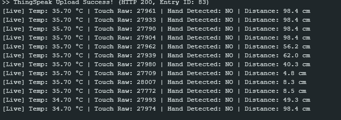
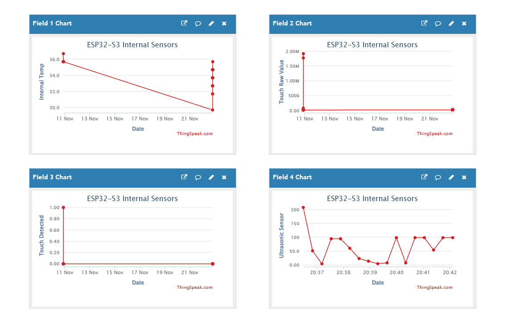

# ESP32-S3 Internal Temperature, Touch & HC-SR04 Sensor → ThingSpeak

Proyek IoT sederhana yang membaca **suhu internal chip ESP32-S3**, **sensor sentuh kapasitif** (kabel jumper di GPIO 4), dan **jarak dari sensor ultrasonik HC-SR04**, lalu mengirim datanya ke **ThingSpeak** setiap 20 detik melalui Wi-Fi.

---

## Demo

[Tonton Demo Video](video/demo-desiot.mp4)

> Klik link di atas untuk membuka video demo (`video/demo-desiot.mp4`).

---

## Fitur

- Membaca suhu internal chip ESP32-S3 (°C)
- Mendeteksi sentuhan tangan dengan pin touch kapasitif (tanpa modul tambahan)
- Kalibrasi otomatis baseline sensor sentuh saat boot
- Mengukur jarak dengan sensor ultrasonik HC-SR04 (cm), dirata-rata dari 3 pembacaan
- Deteksi jarak di luar jangkauan (tidak ada echo)
- Upload 4 field data ke ThingSpeak via HTTP GET
- Monitoring real-time lewat Serial Monitor (setiap ±1 detik)
- Reconnect Wi-Fi otomatis jika koneksi terputus

---

## Hardware

| Komponen | Keterangan |
|---|---|
| ESP32-S3 | Board utama |
| Kabel jumper | Dipasang di **GPIO 4** sebagai elektroda sentuh |
| HC-SR04 | Sensor jarak ultrasonik |
| Resistor 1 kΩ + 2 kΩ | Pembagi tegangan untuk pin ECHO (5V → ±3.3V) |
| Kabel USB | Power & Serial Monitor |

> Sensor suhu yang dipakai adalah sensor **internal** chip, jadi tidak perlu modul eksternal.

---

## Wiring HC-SR04

| HC-SR04 | ESP32-S3 |
|---|---|
| VCC | 5V |
| GND | GND |
| TRIG | `TRIG_PIN` (default GPIO 17) |
| ECHO | `ECHO_PIN` (default GPIO 18) **melalui pembagi tegangan** |

Pembagi tegangan pada ECHO:

```
ECHO ── 1kΩ ──┬── ECHO_PIN (ESP32-S3)
              │
             2kΩ
              │
             GND
```

> Pin ECHO mengeluarkan 5V, sedangkan GPIO ESP32-S3 hanya mendukung 3.3V. Tanpa pembagi tegangan, pin ESP32 bisa rusak.

Hindari pin berikut untuk TRIG/ECHO: GPIO 4 (touch), 0/3/45/46 (strapping pin), dan 19/20 (USB).

---

## Mapping Field ThingSpeak

| Field | Data | Contoh |
|---|---|---|
| `field1` | Suhu internal (°C) | `42.50` |
| `field2` | Nilai mentah touch | `35210` |
| `field3` | Status sentuhan (1 = disentuh, 0 = tidak) | `1` |
| `field4` | Jarak HC-SR04 (cm) | `23.4` |

> `field4` hanya dikirim jika pembacaan jarak valid, sehingga data gagal tidak muncul sebagai angka 0 di grafik.

---

## Cara Kerja Kode

Kode lengkap ada di [`src/main.ino`](src/main.ino).

### 1. Kalibrasi Sensor Sentuh (`calibrateTouchSensor`)
Saat boot, ESP32 mengambil **50 sampel** `touchRead()` selama ±1 detik ketika kabel **tidak disentuh**, lalu menghitung rata-ratanya sebagai **baseline**.

```
threshold = baseline + (baseline × 25%)
```

Pada ESP32-S3, nilai touch **naik** ketika disentuh (berbeda dengan ESP32 klasik yang turun). Jadi jika nilai > threshold → tangan terdeteksi. Kalibrasi dilakukan **sebelum Wi-Fi aktif** agar pembacaan tidak terganggu noise RF.

### 2. Pengukuran Jarak (`readDistanceCm` & `readDistanceAveraged`)
1. TRIG diberi pulsa HIGH selama **10 µs** untuk memulai pengukuran.
2. HC-SR04 memancarkan gelombang ultrasonik, lalu pin ECHO bernilai HIGH selama waktu tempuh pulang-pergi gelombang.
3. Durasi diukur dengan `pulseIn()` (timeout **30 ms**, setara ±5 m).
4. Durasi dikonversi ke jarak:

```
jarak (cm) = durasi (µs) × 0.0343 / 2
```

Angka `0.0343` adalah kecepatan suara dalam cm/µs, dan dibagi 2 karena gelombang menempuh jarak pergi dan pulang. Jika tidak ada echo, fungsi mengembalikan `-1`.

`readDistanceAveraged()` mengambil **3 pembacaan** dengan jeda **60 ms** (agar echo tidak saling tumpang tindih), lalu merata-ratakan pembacaan yang valid untuk mengurangi noise.

### 3. Koneksi Wi-Fi
ESP32 diset ke mode Station (`WIFI_STA`) dan menunggu sampai status `WL_CONNECTED`, lalu menampilkan alamat IP.

### 4. Loop Utama
- `temperatureRead()` → membaca suhu internal chip
- `touchRead(TOUCH_PIN)` → membaca nilai kapasitansi
- Membandingkan nilai touch dengan threshold → `isTouched`
- `readDistanceAveraged()` → membaca jarak HC-SR04
- Mencetak status live ke Serial Monitor

### 5. Upload ke ThingSpeak (setiap 20 detik)
Timer non-blocking dengan `millis()` memastikan upload hanya terjadi tiap 20 detik (ThingSpeak versi gratis membatasi minimal **15 detik** per update).

Data dikirim lewat HTTP GET ke endpoint update ThingSpeak:

```
http://api.thingspeak.com/update?api_key=<WRITE_API_KEY>&field1=<temp>&field2=<touch>&field3=<0|1>&field4=<jarak>
```

---

## Mengapa ThingSpeak Bisa Membalas

1. **Endpoint `/update` menerima HTTP GET** – ThingSpeak mengizinkan data dikirim lewat query string, jadi cukup satu URL tanpa body/JSON.
2. **Write API Key valid** – key di parameter `api_key` menentukan channel tujuan dan memberi izin menulis.
3. **Interval ≥ 15 detik** – request tidak ditolak karena rate limit.
4. **Balasan server** – jika berhasil, ThingSpeak mengembalikan **HTTP 200** dengan body berisi **Entry ID** (nomor urut data, misal `57`). Kode menampilkan ini di Serial Monitor:

```
>> ThingSpeak Upload Success! (HTTP 200, Entry ID: 57)
```

| Respons | Arti |
|---|---|
| `HTTP 200` + angka > 0 | Data berhasil tersimpan |
| `HTTP 200` + `0` | Ditolak (API key salah / terlalu cepat) |
| Kode negatif | Gagal koneksi (Wi-Fi/DNS/server) |

---

## Hasil Pembacaan Live (Serial Monitor)



Contoh output:

```
--- ESP32-S3 Internal Temp, Touch & HC-SR04 Sensor ---
Calibrating touch wire... DO NOT TOUCH the jumper wire.
Calibration complete! Baseline: 28000 | Trigger Threshold: 35000
Connecting to Wi-Fi....
Connected! IP Address: 192.168.1.10
[Live] Temp: 41.80 °C | Touch Raw: 28150 | Hand Detected: NO | Distance: 23.4 cm
[Live] Temp: 41.90 °C | Touch Raw: 52300 | Hand Detected: YES | Distance: 8.7 cm
[Live] Temp: 41.90 °C | Touch Raw: 28120 | Hand Detected: NO | Distance: OUT OF RANGE
>> ThingSpeak Upload Success! (HTTP 200, Entry ID: 12)
```

---

## Hasil di Dashboard ThingSpeak



Grafik menampilkan data `field1` (suhu), `field2` (nilai touch), `field3` (status sentuhan), dan `field4` (jarak) yang masuk setiap 20 detik.

---

## Cara Menjalankan

1. Install **Arduino IDE** + board package **ESP32 by Espressif**.
2. Pilih board **ESP32S3 Dev Module**.
3. Buat channel di [ThingSpeak](https://thingspeak.com) dan aktifkan **4 field**.
4. Rangkai HC-SR04 sesuai tabel wiring (jangan lupa pembagi tegangan di ECHO).
5. Buka `src/main.ino`, lalu isi kredensial dan pin:
   ```cpp
   const char* ssid = "NAMA_WIFI";
   const char* password = "PASSWORD_WIFI";
   const char* thingSpeakApiKey = "WRITE_API_KEY";

   const int TRIG_PIN = 17;
   const int ECHO_PIN = 18;
   ```
6. Upload kode, buka Serial Monitor (**115200 baud**).
7. **Jangan sentuh kabel** saat kalibrasi berjalan.
8. Cek grafik di tab *Private View* channel ThingSpeak.

---

## Catatan

- Suhu internal mencerminkan suhu **chip**, bukan suhu ruangan (biasanya lebih tinggi).
- Jika sensitivitas sentuh kurang pas, ubah persentase `0.25` pada threshold.
- Jangkauan efektif HC-SR04 sekitar **2–400 cm**. Objek terlalu dekat, terlalu jauh, atau permukaan miring/lunak bisa menghasilkan `OUT OF RANGE`.
- Jika `field4` tidak muncul di grafik, pastikan Field 4 sudah diaktifkan di *Channel Settings*.
- Jangan push password Wi-Fi dan API key asli ke repo publik.

---

## Struktur Folder

```
Desiot/
├── .vscode/
├── img/
│   ├── live-reading.png
│   └── thingspeak.png
├── src/
│   └── main.ino
├── video/
│   └── demo-desiot.mp4
└── readme.md
```