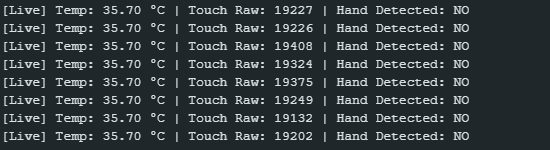
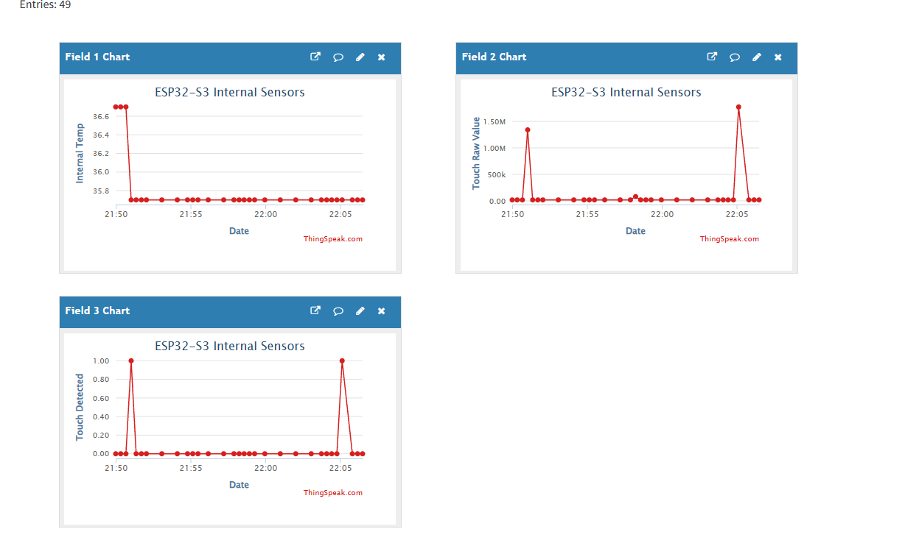

# ESP32-S3 Internal Temperature & Touch Sensor → ThingSpeak

Proyek IoT sederhana yang membaca **suhu internal chip ESP32-S3** dan **sensor sentuh kapasitif** (kabel jumper di GPIO 4), lalu mengirim datanya ke **ThingSpeak** setiap 20 detik melalui Wi-Fi.

---

## 🎬 Demo

[](video/demo-desiot.mp4)

> Klik tombol di atas untuk membuka video demo (`video/demo-desiot.mp4`).

---

## 📋 Fitur

- Membaca suhu internal chip ESP32-S3 (°C)
- Mendeteksi sentuhan tangan dengan pin touch kapasitif (tanpa modul tambahan)
- Kalibrasi otomatis baseline sensor sentuh saat boot
- Upload 3 field data ke ThingSpeak via HTTP GET
- Monitoring real-time lewat Serial Monitor (setiap 1 detik)
- Reconnect Wi-Fi otomatis jika koneksi terputus

---

## 🔧 Hardware

| Komponen | Keterangan |
|---|---|
| ESP32-S3 | Board utama |
| Kabel jumper | Dipasang di **GPIO 4** sebagai elektroda sentuh |
| Kabel USB | Power & Serial Monitor |

> Sensor suhu yang dipakai adalah sensor **internal** chip, jadi tidak perlu modul eksternal.

---

## 📊 Mapping Field ThingSpeak

| Field | Data | Contoh |
|---|---|---|
| `field1` | Suhu internal (°C) | `42.50` |
| `field2` | Nilai mentah touch | `35210` |
| `field3` | Status sentuhan (1 = disentuh, 0 = tidak) | `1` |

---

## ⚙️ Cara Kerja Kode

Kode lengkap ada di [`src/main.ino`](src/main.ino).

### 1. Kalibrasi Sensor Sentuh (`calibrateTouchSensor`)
Saat boot, ESP32 mengambil **50 sampel** `touchRead()` selama ±1 detik ketika kabel **tidak disentuh**, lalu menghitung rata-ratanya sebagai **baseline**.

```
threshold = baseline + (baseline × 25%)
```

Pada ESP32-S3, nilai touch **naik** ketika disentuh (berbeda dengan ESP32 klasik yang turun). Jadi jika nilai > threshold → tangan terdeteksi. Kalibrasi dilakukan **sebelum Wi-Fi aktif** agar pembacaan tidak terganggu noise RF.

### 2. Koneksi Wi-Fi
ESP32 diset ke mode Station (`WIFI_STA`) dan menunggu sampai status `WL_CONNECTED`, lalu menampilkan alamat IP.

### 3. Loop Utama (setiap 1 detik)
- `temperatureRead()` → membaca suhu internal chip
- `touchRead(TOUCH_PIN)` → membaca nilai kapasitansi
- Membandingkan nilai touch dengan threshold → `isTouched`
- Mencetak status live ke Serial Monitor

### 4. Upload ke ThingSpeak (setiap 20 detik)
Timer non-blocking dengan `millis()` memastikan upload hanya terjadi tiap 20 detik (ThingSpeak versi gratis membatasi minimal **15 detik** per update).

Data dikirim lewat HTTP GET ke endpoint update ThingSpeak:

```
http://api.thingspeak.com/update?api_key=<WRITE_API_KEY>&field1=<temp>&field2=<touch>&field3=<0|1>
```

---

## ✅ Mengapa ThingSpeak Bisa Membalas

1. **Endpoint `/update` menerima HTTP GET** – ThingSpeak mengizinkan data dikirim lewat query string, jadi cukup satu URL tanpa body/JSON.
2. **Write API Key valid** – key di parameter `api_key` menentukan channel tujuan dan memberi izin menulis.
3. **Interval ≥ 15 detik** – request tidak ditolak karena rate limit.
4. **Balasan server** – jika berhasil, ThingSpeak mengembalikan **HTTP 200** dengan body berisi **Entry ID** (nomor urut data, misal `57`). Kode menampilkan ini di Serial Monitor:

```
>> ThingSpeak Upload Success! (HTTP 200, Entry ID: 57)
```

| Respons | Arti |
|---|---|
| `HTTP 200` + angka > 0 | Data berhasil tersimpan |
| `HTTP 200` + `0` | Ditolak (API key salah / terlalu cepat) |
| Kode negatif | Gagal koneksi (Wi-Fi/DNS/server) |

---

## 🖥️ Hasil Pembacaan Live (Serial Monitor)



Contoh output:

```
--- ESP32-S3 Internal Temp & Touch Sensor ---
Calibrating touch wire... DO NOT TOUCH the jumper wire.
Calibration complete! Baseline: 28000 | Trigger Threshold: 35000
Connecting to Wi-Fi....
Connected! IP Address: 192.168.1.10
[Live] Temp: 41.80 °C | Touch Raw: 28150 | Hand Detected: NO
[Live] Temp: 41.90 °C | Touch Raw: 52300 | Hand Detected: YES
>> ThingSpeak Upload Success! (HTTP 200, Entry ID: 12)
```

---

## 📈 Hasil di Dashboard ThingSpeak



Grafik menampilkan data `field1` (suhu), `field2` (nilai touch), dan `field3` (status sentuhan) yang masuk setiap 20 detik.

---

## 🚀 Cara Menjalankan

1. Install **Arduino IDE** + board package **ESP32 by Espressif**.
2. Pilih board **ESP32S3 Dev Module**.
3. Buat channel di [ThingSpeak](https://thingspeak.com) dengan **3 field**.
4. Buka `src/main.ino`, lalu isi kredensial:
   ```cpp
   const char* ssid = "NAMA_WIFI";
   const char* password = "PASSWORD_WIFI";
   const char* thingSpeakApiKey = "WRITE_API_KEY";
   ```
5. Upload kode, buka Serial Monitor (**115200 baud**).
6. **Jangan sentuh kabel** saat kalibrasi berjalan.
7. Cek grafik di tab *Private View* channel ThingSpeak.

---

## ⚠️ Catatan

- Suhu internal mencerminkan suhu **chip**, bukan suhu ruangan (biasanya lebih tinggi).
- Jika sensitivitas sentuh kurang pas, ubah persentase `0.25` pada threshold.
- Jangan push password Wi-Fi dan API key asli ke repo publik.

---

## 📁 Struktur Folder

```
Desiot/
├── .vscode/
├── img/
│   ├── live-reading.png
│   └── thingspeak.png
├── src/
│   └── main.ino
├── video/
│   └── demo-desiot.mp4
└── readme.md
```